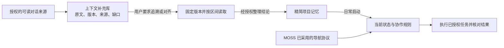

# AI Memory System

面向长期项目和多 Agent 协作的本地工具包：**用精简记忆接续工作，用对话原文追溯依据，用 MOSS 导航推进人设定的目标。**

当前本地候选：`0.2.0-rc.1`。[预发布说明](docs/PRERELEASE.md)｜[MOSS 试用与接入](docs/MOSS.md)。

A local toolkit for compact project memory, on-demand conversation provenance,
and opt-in MOSS project navigation.
See the [English quick start](docs/QUICKSTART.en.md).

这是一套文件约定和 Python CLI。它不训练模型，也不把每次对话全部塞回提示词。



## 能做什么

- 初始化独立私有数据目录；未启用 MOSS 时启动读取 5 个精简文件，启用后增加项目简介、固定导航协议和采用依据。
- 显式安装 MOSS，默认用于当前及未来登记项目；支持项目/全局停用、版本检查和仅含当前记录的私有交接快照。
- 从已支持的 Codex 日志、规范化 JSON 或单份文本导入可见对话。保留来源、缺口和不可变版本，同一对话可关联多个项目。
- 校验存储完整性，并从保留的可见来源重新解析，检查来源与导出记录是否对应。
- 建立固定版本的全文或主题阅读计划，分别记录“已取回”和调用者确认的“已阅读”。
- 对显式配置的来源做增量同步。默认关闭；调度器由使用者另外配置。
- 通过可移植的 `archive-project-context` skill，把选定的 Hermes 会话导出或
  Claude Code 主会话/子 Agent JSONL 转为可见记录，也可直接导入 ChatGPT 的真实
  `read_thread` 分页响应，分别关联到同一项目。当前是经过合成测试的格式子集，
  实际平台接入仍需验收；skill 本身不提供定时器或 ChatGPT 原文获取接口。

## 快速试用

需要 Python 3.10+，运行代码只依赖标准库。当前已在 macOS 验证；Linux 尚未验证，Windows 暂不支持文件锁和权限实现。

在仓库根目录执行，无需安装第三方依赖：

```sh
python3 -B tools/demo.py
python3 -B tools/moss_demo.py
python3 -B -m unittest discover -s tests -q
python3 -B tools/audit_public_tree.py
```

演示仅使用合成对话，在临时目录完成初始化、导入、来源回放校验和阅读取回，然后删除临时数据。它不会确认自己“已经读懂”示例。

创建自己的空数据目录（目标必须不存在，父目录需已存在，且不能位于 Git 仓库内）：

```sh
python3 -B tools/workspace.py init --workspace "$HOME/ai-memory-data" --project demo
python3 -B tools/workspace.py startup --workspace "$HOME/ai-memory-data" --project demo
```

这两个命令不会读取 AI 平台的配置或历史。已有项目数据不会被覆盖。

导入仓库中的合成示例，再按需读取：

```sh
python3 -B tools/context_library.py --root "$HOME/ai-memory-data/AI-Context" import-transcript --project demo --provider example --conversation-id synthetic-design-001 --title "Synthetic notebook design" --source examples/synthetic-conversation.json
python3 -B tools/context_library.py --root "$HOME/ai-memory-data/AI-Context" list --project demo
python3 -B tools/context_library.py --root "$HOME/ai-memory-data/AI-Context" read --project demo --conversation synthetic-design-001 --start 1 --end 3
```

## 目录与进一步使用

| 目录 | 内容 |
| --- | --- |
| `tools/` | 初始化、加载、导入、版本选择、来源校验、阅读和同步工具 |
| `templates/` | 不含个人信息的记忆、协作约定与关闭状态的同步配置 |
| `skills/` | 可供协作 Agent 使用的原文归档流程与导入助手 |
| `examples/` | 明确标注的合成对话 |
| `tests/` | 在临时目录运行的合成测试 |
| `docs/` | 设计、CLI 使用、平台接入、来源与本地验收记录 |

- [MOSS 导航、停用与交接](docs/MOSS.md)
- [预发布准备](docs/PRERELEASE.md)
- [日常使用与原文读取](docs/USAGE.md)
- [两层结构与数据边界](docs/ARCHITECTURE.md)
- [来源格式与自动同步](docs/INTEGRATIONS.md)
- [跨 Agent 原文归档 skill](skills/archive-project-context/SKILL.md)
- [代码来源及公开范围](docs/PROVENANCE.md)
- [验证结果](docs/VALIDATION.md)
- [贡献说明](CONTRIBUTING.md)

## 当前边界

“原文”指来源快照中能获得的可见内容。被删消息、缺失分支、截断输出和未取得的附件不会被恢复；常见凭据会被标记后遮蔽。原始日志不会被修改。

MOSS 的读取与交接可供多个 Agent 使用。客户端自动触发需要单独接入；交接快照不等于实时本地访问，多个 Agent 也不自动获得并发写入或调度权限。

ChatGPT 的 `read_thread` 导入接受宿主工具保存的实际响应；本仓库不提供 ChatGPT 登录、网页抓取或通用账户导出客户端。其他平台的原生导出包需要单独核实格式，目前可使用规范化 JSON 或单份文本。

归档可以包含隐私；自动遮蔽仅识别部分凭据格式，不能把真实对话变成可公开数据。私有数据应存放在仓库之外。文件在本地存储，模型是否在云端运行由使用者的 AI 客户端决定。

MIT 许可证，见 [LICENSE](LICENSE)。
